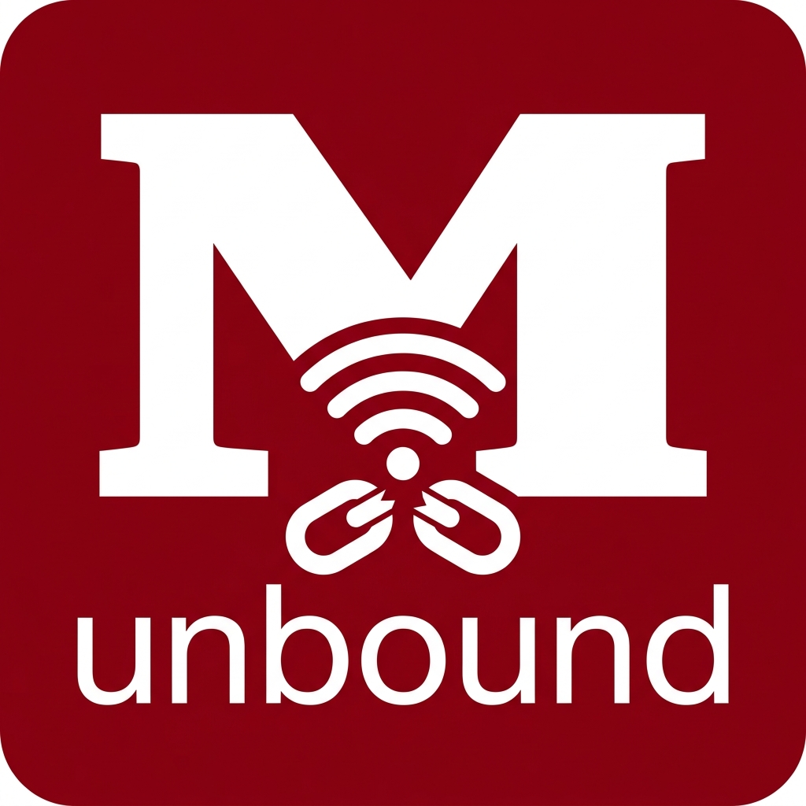

<p align="center">
  
</p>

# ioBroker.miele-unbound

[](https://www.npmjs.com/package/iobroker.miele-unbound)
[](LICENSE)

*Read this in another language: [Deutsche Dokumentation](README_de.md).*

A high-performance, local-first ioBroker adapter connecting modern **Miele@Home** appliances
directly over your local area network (LAN) without continuous cloud reliance.

By leveraging the local `MieleH256` / DOP2 protocol on port 80, `ioBroker.miele-unbound` provides
sub-second state updates, maximum privacy, and complete independence from internet outages or Miele
cloud rate limits. At the same time, it incorporates comprehensive device-type profiles and data point
definitions for over 30 appliance classes.

## Key Features

- **100% Local Operation:** Speaks directly to appliance communication modules (e.g. EK037, EK057).
- **Sub-second Response Times:** Instant state updates without third-party cloud polling delays.
- **Rich Device Profiles:** Over 30 appliance types with dedicated states, roles, and units.
- **Human-Readable & Raw Values:** Enriched plain-text statuses, program names, and phases.
- **Hardware-Safe Polling:** Strict sequential request queue per appliance to prevent XKM crashes.
- **Painless Credential Migration:** Encrypted export/import and manual entry for scratch installs.
- **Remote Control (Opt-in):** Start, stop, pause, power, and lighting controls via DOP2 opcodes.
- **Real-time Push (SuperVision, Opt-in):** Built-in local HTTP listener for instant state updates.

## Quick Start & Setup Guide

1. Install the adapter and create an instance.
2. In the **Login & Pairing** tab, select your country and follow the step-by-step login below.
3. Paste the captured `miele://...` address into the **miele:// Redirect URL** field and click **Fetch GroupKey**.
4. Save settings. The adapter discovers your appliances and creates their states.

If running in Docker with bridge networking, auto-discovery cannot receive multicast packets — enter appliance IP addresses manually on the **Appliances** tab. See [Network & Docker](#network-ports--docker).

### The Login, Step by Step

The final redirect address uses the `miele://` mobile app scheme. Desktop web browsers cannot handle this custom scheme, causing the browser to halt on a spinning wheel or a loading error. **This interruption is expected and indicates success.**

1. **Prepare Browser DevTools:**
   - Click **Open Login Page** (a new browser tab opens).
   - Press **F12** (or right-click and select *Inspect*) to open Developer Tools.
   - Switch to the **Network** tab.
   - Ensure network requests are retained:
     - **Chrome / Edge / Brave:** Check **Preserve log**.
     - **Firefox:** Click the gear icon ⚙️ and check **Persist Logs**.
2. **Sign In:**
   - Enter your standard Miele app account email and password.
   - Complete the sign-in. The browser will halt on a spinning circle or display a navigation error.
3. **Copy Redirect URL:**
   - In the DevTools **Network** tab, scroll to the last recorded request (often highlighted in red).
   - Look for an entry starting with `redirect?redirect_uri=miele...` or `miele://oauth2-code/...`.
   - Right-click the request ➔ **Copy** ➔ **Copy URL**.
   - Paste the copied address into the adapter's **miele:// Redirect URL** field and click **Fetch GroupKey**.

The household GroupID and GroupKey are stored in the instance configuration (with the GroupKey safely encrypted). This pairing process is only required once.

### Alternative: Encrypted Backup & Manual Credentials

In the **Credentials & Backup** tab, the adapter provides two flexible options for server migrations, fresh installs, or disaster recovery:

#### What does "Encrypted Backup" do?
The local `GroupKey` is the master cryptographic key granting local LAN access to all Miele appliances in your household. With the encrypted backup feature, you can safely export your credentials and migrate them to another system **without ever needing to repeat the Miele cloud login or DevTools token capture**:
* **What is included in the backup?**
  * The household **GroupID** and the secret **GroupKey**.
  * All manually configured appliances and IP addresses (**Appliances table**).
  * Creation timestamp.
* **How is it encrypted?**
  * Strong industry-standard **AES-256-GCM** (authenticated encryption with built-in tampering protection).
  * Key derivation from your chosen **Passphrase** via **PBKDF2** with 100,000 rounds (SHA-256) and a cryptographically random 16-byte salt.
  * This guarantees that your sensitive local LAN key is never exported or stored in plain text and can safely be stored in external notes or backups.
* **Exporting:** Ensure the instance is running ➔ enter a strong passphrase ➔ click **Export Backup** ➔ copy and store the generated backup string safely.
* **Restoring:** On a new or reinstalled instance, ensure the adapter instance is running (green status) ➔ paste the backup string and enter your passphrase ➔ click **Import / Restore** ➔ your credentials and manual appliance IPs are immediately restored.

#### Manual Entry
Alternatively, if you already have your household GroupID and 64-character hexadecimal GroupKey saved from a previous installation, you can paste them directly into the respective fields.

## Network: Ports & Docker

| Direction | Port | Purpose | Required |
|---|---|---|---|
| In/Out | UDP 5353 (mDNS) | Automatic LAN device discovery | For auto-discovery |
| Outbound | TCP 80 ➔ appliances | Local DOP2/H256 polling and controls | Yes |
| Outbound | TCP 443 ➔ miele-iot.com | Fetch initial GroupKey pairing token | One-time login only |

**Docker & Bridge Networking:**
Containers with bridge networking do not forward multicast UDP traffic. In this configuration, automatic mDNS discovery will not find appliances. You can either:
1. Run the container with `network_mode: host` to enable multicast auto-discovery.
2. Or enter the IP addresses of your Miele appliances manually in the **Appliances** tab.

<a id="time-server"></a>
## Appliance Time Server & Clock Synchronization (Optional)

*For the German version of this section, see [README_de.md](README_de.md#time-server).*

Miele appliances do **not** use standard NTP (UDP port 123) to synchronize their clock. Instead, they send an unencrypted HTTP GET request to a hardcoded Miele endpoint on **TCP port 80**:

```http
GET http://ntp.mcs2.miele.com/V2/NTP/ HTTP/1.1
Host: ntp.mcs2.miele.com
Accept: application/vnd.miele.v1+json
```

and expect a JSON response with the current Unix timestamp in seconds (`{"time":1795100000}`).

Appliances without internet connectivity (e.g. blocked via parental controls/firewall or placed in an isolated IoT VLAN) drift over time, fail to recover the clock after a power outage, and do not switch Daylight Saving Time automatically. The adapter includes a built-in HTTP time server that answers `/V2/NTP/` locally.

> **⚠️ IMPORTANT: Why a DNS entry alone is NOT sufficient!**
> A DNS server (such as Pi-hole, AdGuard Home, or your router) can only resolve the domain name `ntp.mcs2.miele.com` to an **IP address** (your ioBroker host IP) — **DNS cannot change the port number!**
> Because the Miele firmware strictly connects to **TCP port 80**, while the ioBroker adapter runs without `root` privileges on an unprivileged port (default: **TCP 8780**), you must **both** redirect the domain via DNS **and** forward incoming traffic on **port 80** of the ioBroker host to **port 8780**.

### Setup Variant 1: Local DNS (Pi-hole / AdGuard Home) + Port 80 Forwarding

#### Step 1: Enable the Time Server in ioBroker
1. Open the instance settings of `miele-unbound` and switch to the **Settings** tab.
2. Enable **Answer appliances time request (Miele time server)**.
3. Keep **Time Server Port (TCP)** at **`8780`** (do not use the same port as the SuperVision Push listener) and leave **Bind Address** empty (`0.0.0.0`, all interfaces).
4. Click **Save and Close**.

#### Step 2: Create a Local DNS Record
Point `ntp.mcs2.miele.com` to the IP address of the ioBroker host running the `miele-unbound` instance (e.g. `192.168.1.50`):
- **Pi-hole:** Go to **Local DNS** ➔ **DNS Records** (or **Settings** ➔ **Local DNS Records** in Pi-hole v6) ➔ enter **Domain:** `ntp.mcs2.miele.com` and **IP Address:** `<ioBroker-Host-IP>` ➔ click **Add**. *(If you run two redundant Pi-hole servers, add the record on both.)*
- **AdGuard Home:** Go to **Filters** ➔ **DNS rewrites** ➔ click **Add DNS rewrite** ➔ enter `ntp.mcs2.miele.com` and `<ioBroker-Host-IP>`.

#### Step 3: Forward Port 80 to Port 8780 on the ioBroker Host
Choose the option matching your ioBroker installation:

- **Option A — Linux Host / Raspberry Pi / Debian / Ubuntu / LXC (when Port 80 is free):**
  Check via SSH that nothing else is listening on port 80 (`sudo ss -tulpn | grep ':80 '`), then install `iptables-persistent` and add a kernel-level port redirect from `80` to `8780`:
  ```bash
  sudo apt update && sudo apt install -y iptables-persistent
  sudo iptables -t nat -A PREROUTING -p tcp --dport 80 -j REDIRECT --to-port 8780
  sudo netfilter-persistent save
  ```
- **Option B — Docker Container (Bridge Networking):**
  Map port `80` on the Docker host to port `8780` inside the container:
  ```yaml
  ports:
    - "80:8780"
  ```
- **Option C — Reverse Proxy (`nginx`) when Port 80 is already in use on the host:**
  If another web server already occupies port 80 on the ioBroker host, add a virtual host that proxies requests for `Host: ntp.mcs2.miele.com` to `127.0.0.1:8780`:
  ```nginx
  server {
      listen 80;
      server_name ntp.mcs2.miele.com;

      location /V2/NTP {
          proxy_pass http://127.0.0.1:8780;
          proxy_set_header Host $host;
      }
  }
  ```

#### Step 4: Verify the Setup
From any computer on your local network (e.g. Windows PowerShell, macOS, or Linux terminal), run:
```bash
curl http://ntp.mcs2.miele.com/V2/NTP/
```
If the response looks like `{"time":1795100299}`, both the DNS resolution and the port 80 ➔ 8780 redirect are working properly.

> **Multi-Host / Slave Note:** In an ioBroker multi-host environment (Master/Slave), the DNS record and the port 80 ➔ 8780 forwarding must always be configured on the host IP where the `miele-unbound` instance actually runs. If you later move the instance from a Slave to the Master host, update the DNS record in Pi-hole/AdGuard to the Master IP and configure the port 80 ➔ 8780 redirect on the Master.

### Setup Variant 2: Router Destination-NAT (DNAT)
If your router/firewall supports full Destination-NAT (e.g. OPNsense, pfSense, UniFi, MikroTik), you can redirect both the IP and the port directly at the router without changing DNS or host `iptables`:
- **Source:** Miele appliances (or IoT VLAN)
- **Destination:** `ntp.mcs2.miele.com` (or any destination) on **TCP Port 80**
- **Redirect Target:** `<ioBroker-Host-IP>`, **TCP Port 8780**
- *(If ioBroker resides in the same subnet as the appliances, also enable Source-NAT / Hairpin-NAT / Masquerade.)*

### Active Appliance Clock Synchronization (`keepDeviceClock`)
Some appliances (e.g. ovens) also expose their local wall clock time via `Settings/TimeSync`. Enabling **Keep appliance clock on local time** checks appliances on startup and every hour, automatically correcting deviations larger than 2 minutes via a signed PUT request.

## Privacy & Local Operation

The adapter operates **strictly local-first**. The one-time Miele account login only serves to retrieve the household encryption key (`GroupKey`). During normal day-to-day operation:
- The adapter does not communicate with any cloud service.
- No user passwords or access tokens are stored or sent anywhere.
- Device state changes, energy metrics, and telemetry remain entirely inside your local network.

## Object Hierarchy

Each appliance is represented by its serial number as the device object:

- **`<serial>.info`**: Reachability, technical model name, material number, firmware version, IP.
- **`<serial>.state`**: Operating status, program ID and name, phase, remaining time, door, errors.
- **`<serial>.sensors`**: Temperature zones, spin speeds, drying steps, battery, ventilation.
- **`<serial>.eco`**: Targeted EcoFeedback energy (kWh/Wh), water consumption, and heating metrics.
- **`<serial>.control`**: Remote actions (start, stop, pause, power, lighting, and program selection via `control.programId`) when enabled.

## Legal Disclaimer

This is an **unofficial, community-developed** project and is **not affiliated with or endorsed by [Miele & Cie. KG](https://www.miele.com/)**. "Miele", "Miele@home", and related trademarks belong to Miele & Cie. KG and are used solely for identification and compatibility purposes.

The adapter utilizes local communication protocols reverse-engineered by the open-source community. Usage is at your own risk. The software is distributed under the MIT license without warranty of any kind.

## Changelog
### **WORK IN PROGRESS**
- Add detailed time server DNS/port-80 setup guide and clickable README link in Admin UI

### 1.7.1 (2026-11-16)
- Hide command and light buttons on Device Manager cards when appliance is offline
- Add control.canLightOn and control.canLightOff indicators and reset control.can* on stop
- Refine German (Heißluft plus, Automatik, drying steps) and French (Allumer, Éteindre) labels

### 1.7.0 (2026-11-15)
- Add remote program selection via control.programId (DOP2 leaf 2/1577) and Device Manager dropdown

### 1.6.2 (2026-11-15)
- Correct MobileStart detection from RemoteEnable array to enable remote start

### 1.6.1 (2026-11-12)
- Remove redundant state.estimatedEndtime in favor of state.estimatedEndTimeText
- Device Manager cards render status, programme, phase, type and drying step in system language
- Raw states (status, programId, etc.) use localized option tables in ioBroker system language
- Import Home Assistant translations with corrections for missing languages
- Add descriptions (common.desc) in all 11 languages for control.can* and state.progress

### 1.6.0 (2026-11-12)
- Add ioBroker Device-Manager integration with live cards, status indicators, and actions
- Add state.progress (programme progress in percent 0..99%)
- Add control.canPowerOn, canPowerOff, canStart, canPause, canStop indicators

Older changelog entries can be found in [CHANGELOG_OLD.md](CHANGELOG_OLD.md).

## License

MIT License

Copyright (c) 2026 meistermopper <meister.mopper@gmail.com>

See [LICENSE](LICENSE) for more details.
